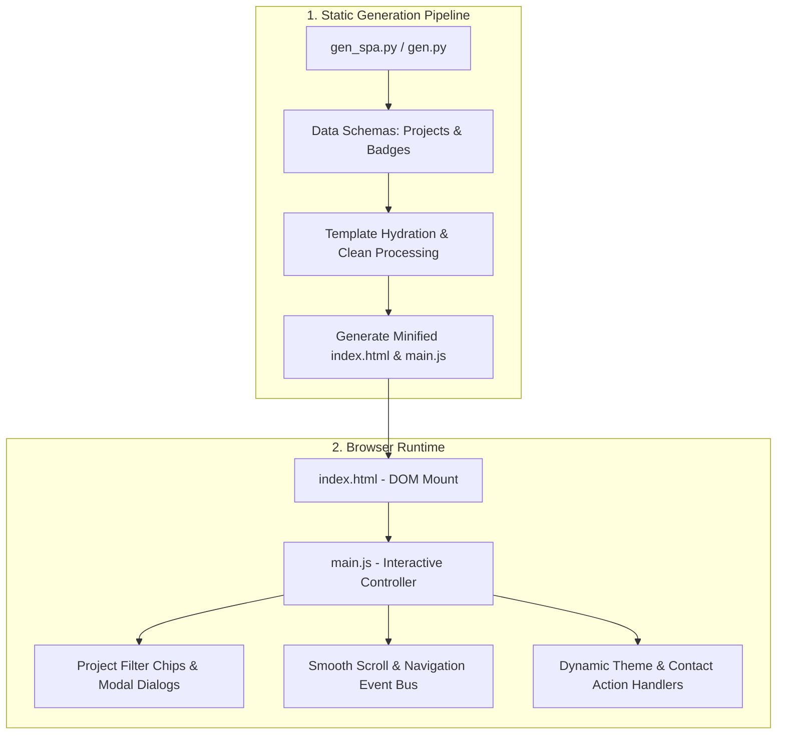

<div align="center">

# 💼 HARI NARAYANA — DIGITAL PORTFOLIO
### Modern, Responsive Developer Portfolio, Interactive Project Gallery & Certification Showcase

[](https://chic-axolotl-a63abd.netlify.app)
[](https://developer.mozilla.org/en-US/docs/Web/JavaScript)
[](https://developer.mozilla.org/en-US/docs/Web/HTML)
[](https://www.python.org/)
[](https://opensource.org/licenses/MIT)

<p align="center">
  A sleek, high-performance personal developer portfolio engineered to showcase engineering projects, verified cloud certifications (including Google Kubernetes Engine), and technical milestones. Powered by automated Python static generation pipelines and lightweight client-side interactions.
</p>

[🌐 Visit Live Portfolio](https://chic-axolotl-a63abd.netlify.app) • [✨ Key Features](#-key-features) • [🏛️ Architecture](#-generation--rendering-architecture) • [🛠️ Tech Stack](#️-tech-stack) • [🚀 Local Setup](#-local-development) • [📁 Structure](#-project-structure)

</div>

---

## 🌟 Key Features

* **🎨 Interactive Project Gallery**: Highlights flagship engineering systems including *Project Sentinel*, *FFCS Timetable Architect*, *DeskLock*, and *CineKeep* with live tags and demo links.
* **🎖️ Verified Certifications & Badges**: Embedded showcases of industry credentials, including the official Google Kubernetes Skill Badge and cloud certifications.
* **⚡ Python Automated SPA Engine**: Custom Python generation scripts (`gen_spa.py`, `gen.py`) that automate HTML structuring and component synchronization.
* **📱 Ultra-Responsive Glassmorphic UI**: Fluid flexbox and CSS grid foundations guaranteeing pixel-perfect scaling across mobile phones, tablets, and ultrawide desktop monitors.
* **🚀 Blazing CDN Performance**: Zero heavy framework overhead — pure vanilla HTML/JS delivers sub-second initial contentful paint times via Netlify CDN.

---

## 🏛️ Generation & Rendering Architecture



---

## 🛠️ Tech Stack

| Domain | Technologies |
| :--- | :--- |
| **Frontend Foundation** | HTML5, CSS3, Modern Vanilla JavaScript (ES6+) |
| **Site Generator / Tooling** | Python 3 (`gen_spa.py`, `gen.py`, `clean.py`) |
| **Icons & Media** | Lucide Icons, Custom SVG vectors |
| **Hosting & CI/CD** | Netlify Continuous Deployment |

---

## 🚀 Local Development

### Prerequisites
* Python 3.8+ (for running generation scripts or local preview server)
* Web browser

### 1. Clone the Repository
```bash
git clone https://github.com/harinarayana1457-cmyk/My_Portfolio.git
cd My_Portfolio
```

### 2. Regenerate SPA Layout (Optional)
If you modify source templates or project data:
```bash
python gen_spa.py
```

### 3. Preview Locally
Run a lightweight local HTTP server:
```bash
python -m http.server 8080
```
Open `http://localhost:8080` in your web browser.

---

## 📁 Project Structure

```text
My_Portfolio/
├── index.html                # Compiled responsive portfolio single-page application
├── main.js                   # Client-side filtering, interactive modals, and event listeners
├── gen_spa.py                # Automated Single Page Application HTML generator
├── gen.py                    # Static component layout builder
├── clean.py                  # Code cleanup and formatting utility
├── replace.py / replace2.py  # Automated string & template replacement utilities
├── package.json              # Optional npm tooling definitions
├── .gitignore                # Production ignore rules
└── README.md                 # Project documentation
```

---

## 🔗 Connect & Links

* **Live Portfolio**: [chic-axolotl-a63abd.netlify.app](https://chic-axolotl-a63abd.netlify.app)
* **Author**: [Hari Narayana (@harinarayana1457-cmyk)](https://github.com/harinarayana1457-cmyk)
* **LinkedIn**: [](https://www.linkedin.com/in/hari-narayana-035ba1389/)
