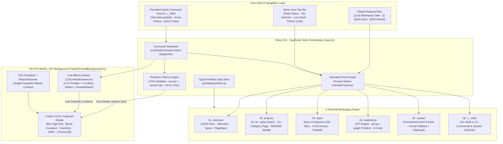

<div align="center">

# 🖥️ HARI_NARAYANA [v3.0] // TERMINAL PORTFOLIO
### *Interactive WebGL2 CRT Developer OS, Stateful Zsh Shell & Engineering Showcase*

An interactive cyber-terminal developer portfolio engineered for **Harinarayana Avvari** (AI Systems Engineer · Full-Stack Developer · ECE @ VIT). Built with a custom 60 FPS WebGL GLSL CRT shader (`ogl`), React 18, TypeScript, Tailwind CSS, and Framer Motion — featuring live phosphor theme switching, a real-time shader FX control deck, `grep`-searchable project archives, and a functional in-browser command-line shell.

---

[](https://chic-axolotl-a63abd.netlify.app)
[](https://react.dev/)
[](https://www.typescriptlang.org/)
[](https://github.com/oframe/ogl)
[](https://tailwindcss.com/)
[](https://www.framer.com/motion/)
[](https://vite.dev/)
[](LICENSE)

<br/>

[🌐 Launch Live Terminal](https://chic-axolotl-a63abd.netlify.app) • [Overview](#-overview) • [System Architecture](#-system-architecture) • [Core Capabilities](#-core-capabilities) • [Interactive Shell & Hotkeys](#-interactive-shell--keyboard-shortcuts) • [WebGL CRT Engine](#-webgl-crt-shader--phosphor-themes) • [Featured Projects](#-curated-project-directory) • [Local Setup](#-local-development--deployment) • [Project Structure](#-project-structure) • [Connect & Author](#-connect--author)

---

</div>

<br/>

## 📖 Overview

**HARI_NARAYANA [v3.0]** reimagines the personal developer portfolio as a tactile, low-latency UNIX / `tmux` workstation running directly in the browser. Rather than static scrolling cards, visitors can navigate via workspace tabs, global keyboard shortcuts (`1–6`, `/`), or an authentic interactive Zsh shell (`hari@node-alpha:~$`) complete with `Tab` autocompletion and command history.

Underneath the glassmorphic terminal chrome runs **`FaultyTerminalBackground`** — a full-bleed custom GLSL fragment shader powered by `ogl` that renders procedural fractional Brownian motion (`fbm`) digit matrices, CRT barrel curvature, scanlines, RGB chromatic aberration, and damped mouse-reactive ripples at 60 FPS without recreating the WebGL context on state changes.

---

## 🏗️ System Architecture



---

## ✨ Core Capabilities

- **🎛️ Full-Bleed 60 FPS WebGL CRT Shader**: Custom GLSL shader (`FaultyTerminalBackground`) featuring procedural `fbm` digit patterns, CRT barrel distortion, scanline modulation, horizontal glitch displacement, RGB chromatic aberration, anti-banding dithering, and global window mouse-ripple tracking.
- **🎨 5 Live Phosphor Themes + Shader FX Drawer**: Switch instantaneously between **Emerald Green**, **Cyberdeck Cyan**, **Retro Amber**, **Ultraviolet**, and **Monochrome White** — simultaneously updating CSS glow tokens and WebGL shader tint uniforms with zero context flicker.
- **💻 Authentic Interactive Shell (`>_ shell`)**: Execute 19+ UNIX-inspired commands (`neofetch`, `whoami`, `ls projects`, `open 1`, `cat bio.md`, `skills`, `experience`, `education`, `certs`, `theme cyan`, `crt glitch`, `sudo hire`) from either the dedicated shell tab or the persistent bottom command dock.
- **📂 `grep`-Searchable Project Directory & README Modal**: Filter 12 curated builds (out of 33+ public GitHub repositories) across 4 engineering categories (`--ai-agents`, `--apis-data`, `--systems-cli`, `--web-ext`) and inspect architecture pipelines, metrics, and highlights inside an interactive `cat ./projects/<slug>/README.md` modal.
- **📊 UNIX-Inspired Telemetry Views**: Explore technical proficiency via an `htop`-style process monitor (`PID 1024–4096`) with 16-segment glowing LED bars, and review career milestones through a `git log --graph --decorate` commit timeline alongside 8 certifications & honors.
- **📡 Resilient Direct Contact Dispatcher**: Send messages directly via asynchronous FormSubmit packets (`200 OK` confirmation) with automatic 1-click Gmail compose fallback and instant clipboard email copying.

---

## ⌨️ Interactive Shell & Keyboard Shortcuts

### Global Keyboard Shortcuts

| Shortcut | Action |
| :--- | :--- |
| `1` – `6` | Switch directly between `overview`, `projects`, `stack`, `experience`, `contact`, and `>_ shell` |
| `/` | Focus the persistent quick command dock from anywhere in the app |
| `Tab` | Autocomplete commands inside the interactive shell |
| `↑` / `↓` | Cycle through your executed shell command history |
| `Esc` | Close the active `ProjectModal` README inspector |

### Built-In CLI Command Reference

| Command | Arguments / Options | Description |
| :--- | :--- | :--- |
| `help` / `?` | *None* | Print all supported terminal commands and usage |
| `whoami` | *None* | Display developer profile, role, VIT degree, and availability status |
| `neofetch` | *None* | Render ASCII monogram alongside node specs, AI stack, and GitHub URL |
| `ls` / `projects` | `[projects]` | List virtual workspace directories or all 12 curated repositories |
| `open` | `<1-12>` | Launch the interactive README modal for a numbered project (e.g., `open 1` for CartWeave) |
| `cat` | `bio.md` | Print the full developer biography buffer |
| `cd` | `<overview \| projects \| stack \| experience \| contact \| shell>` | Jump directly to a workspace pane |
| `skills` / `stack` | *None* | Render ASCII block proficiency bars across all 4 capability groups |
| `experience` / `git` | *None* | Print `git`-formatted career commit history |
| `education` / `edu` | *None* | Output VIT B.Tech ECE degree & specialization details |
| `certs` | *None* | List all 8 verified certifications, fellowships, and awards |
| `github` | *None* | Display GitHub profile link and top flagship repository URLs |
| `contact` | *None* | Show direct email, GitHub, and LinkedIn endpoints |
| `theme` | `<emerald \| cyan \| amber \| violet \| mono>` | Hot-swap the global phosphor color palette & WebGL tint |
| `crt` | `<pause \| play \| glitch \| calm>` | Toggle WebGL shader playback or apply instant glitch/calm shader presets |
| `sudo hire` | *None* | Unlock priority recruiter channel and route directly to the contact packet sender |
| `date` / `echo` | `[text]` | Print current system timestamp or echo arguments to stdout |
| `clear` / `reboot` | *None* | Clear terminal scrollback buffer or replay the WebGL CRT cold-boot reveal |

---

## 🎛️ WebGL CRT Shader & Phosphor Themes

Opening the **Effects** drawer (`Sliders` button in the top bar) exposes real-time GPU uniform controls updated smoothly on the active `ogl` program:

| Uniform / Control | Range | Visual Effect |
| :--- | :--- | :--- |
| **Color Theme** | `Green` · `Cyan` · `Amber` · `Violet` · `Mono` | Updates `--accent` CSS glow tokens & `uTint` `vec3` shader uniform |
| **FX Presets** | `STEALTH` · `BALANCED` · `OVERDRIVE` | One-click shader intensity profiles |
| **Grid Scale (`uScale`)** | `0.7` – `3.5` | Controls density of the procedural `fbm` digit matrix |
| **Glitch (`uGlitchAmount`)** | `0.0` – `4.5` | Modulates horizontal scan-band displacement bursts |
| **CRT Curve (`uCurvature`)** | `0.00` – `0.40` | Adjusts radial barrel distortion across UV coordinates |
| **Scanlines (`uScanlineIntensity`)** | `0.00` – `1.50` | Tunes rolling CRT scanline bar contrast |
| **Chroma AB (`uChromaticAberration`)** | `0.0px` – `6.0px` | Splits RGB channels across screen-space UV offsets |
| **Phosphor (`uBrightness`)** | `0.25` – `1.20` | Scales overall WebGL canvas luminance |

---

## 🗂️ Curated Project Directory

The portfolio indexes **12 featured repositories** (representing **33+ public builds** on GitHub) with architecture breakdowns, metrics, and live deployment links:

| ID | Project | Category | Core Stack | Links |
| :--- | :--- | :--- | :--- | :--- |
| `01` | **CartWeave** | `AI & AGENTS` | TypeScript, MCP (2025-11-25), Claude 3.5, AWS Bedrock, Next.js | [GitHub](https://github.com/harinarayana1457-cmyk/CartWeave) |
| `02` | **Styrud — AI Study Galaxy** | `AI & AGENTS` | Python, FastAPI, Google Gemini, React, Playwright | [GitHub](https://github.com/harinarayana1457-cmyk/Styrud-AI-Study-Galaxy) · [Live](https://styrud-lgf3.vercel.app) |
| `03` | **FaceLedger Blockchain** | `APIs & DATA` | Python, FastAPI, OpenCV (128-D L2), Solidity, React | [GitHub](https://github.com/harinarayana1457-cmyk/HHG-3-FaceLedger-Blockchain) · [Live](https://harinarayana1457-cmyk.github.io/HHG-3-FaceLedger-Blockchain/) |
| `04` | **Project Sentinel** | `AI & AGENTS` | Google Gemini, Firebase Firestore, TypeScript, Python | [GitHub](https://github.com/harinarayana1457-cmyk/Sentinel-Epidemic-Surveillance) |
| `05` | **BookIt & OmniReserve** | `APIs & DATA` | Python, Flask, Normalized SQL, REST API | [GitHub](https://github.com/harinarayana1457-cmyk/BookIt-Multi-Domain-Booking) |
| `06` | **Wallplay** | `SYSTEMS & CLI` | Python, Rich CLI, Win32 ctypes, Pillow | [GitHub](https://github.com/harinarayana1457-cmyk/Wallplay) |
| `07` | **Handdy** | `WEB & EXT` | MediaPipe WASM, Chrome MV3, JavaScript | [GitHub](https://github.com/harinarayana1457-cmyk/Handdy) |
| `08` | **Webdek** | `SYSTEMS & CLI` | React 18, TypeScript, Multi-AST Parser, Tailwind | [GitHub](https://github.com/harinarayana1457-cmyk/Webdek) |
| `09` | **Xplot** | `SYSTEMS & CLI` | Python, NumPy, Matplotlib, XPPAUT/AUTO CLI | [GitHub](https://github.com/harinarayana1457-cmyk/Xplot) |
| `10` | **Ketrac** | `APIs & DATA` | Python, FastAPI, JavaScript, NotebookLM, Vercel | [GitHub](https://github.com/harinarayana1457-cmyk/Ketrac-Playlist-Extractor) · [Live](https://ketrac.vercel.app) |
| `11` | **Viser** | `WEB & EXT` | Next.js 15, React 19, TypeScript, Web Audio API | [GitHub](https://github.com/harinarayana1457-cmyk/Viser) |
| `12` | **FFCS Timetable Optimizer** | `WEB & EXT` | React 18, TypeScript, Constraint Solver, Tailwind | [GitHub](https://github.com/harinarayana1457-cmyk/FFCS-Timetable-Optimizer) |

---

## 🛠️ Tech Stack

| Layer | Technologies |
| :--- | :--- |
| **Frontend Framework** | React 18.3, TypeScript 5.6 (Strict Mode) |
| **WebGL & Shaders** | `ogl` (`Renderer`, `Program`, `Mesh`, `Triangle`), Custom GLSL Vertex & Fragment Shaders |
| **Styling & Motion** | Tailwind CSS 3.4, CSS Custom Properties, Framer Motion 11.15 |
| **Icons & Typography** | Lucide React, `JetBrains Mono`, `Space Grotesk` |
| **Build & Bundler** | Vite 6.0, PostCSS, Autoprefixer |
| **Hosting & CI/CD** | Netlify Continuous Deployment (`netlify.toml` SPA Redirects) |

---

## 🚀 Local Development & Deployment

### Prerequisites
- **Node.js**: `v18+` (recommended `v20 LTS`)
- **npm**: `v9+`

### 1. Clone the Repository
```bash
git clone https://github.com/harinarayana1457-cmyk/My_Portfolio.git
cd My_Portfolio
```

### 2. Install Dependencies & Start Dev Server
```bash
npm install
npm run dev
```
Open `http://localhost:5173` in your browser to explore the terminal locally with Vite HMR.

### 3. Production Type-Check & Build
```bash
npm run build
npm run preview
```
Vite outputs the optimized static bundle to `dist/`, pre-configured via `netlify.toml` (`npm run build` -> `dist/` with SPA `200` fallback routing) for zero-config deployment on **Netlify** or **Vercel**.

---

## 📂 Project Structure

```text
My_Portfolio/
├── src/
│   ├── components/
│   │   ├── AsciiBanner.tsx              # Responsive ASCII monogram & version header
│   │   ├── BootSequence.tsx             # Terminal cold-boot sequence component
│   │   ├── CrtControlsDrawer.tsx        # Real-time WebGL uniform sliders, presets & theme picker
│   │   ├── FaultyTerminalBackground.tsx # 60 FPS OGL WebGL2 CRT fragment/vertex shader canvas
│   │   ├── InteractiveShell.tsx         # Zsh-style CLI interpreter, autocomplete & history
│   │   ├── ProjectModal.tsx             # Interactive `cat ./projects/<slug>/README.md` modal
│   │   └── Sections.tsx                 # Overview, Projects, Stack (htop), Experience & Contact panes
│   ├── data/
│   │   └── portfolio.ts                 # Typed profile, themes, 12 projects, skills, git log & certs
│   ├── types/
│   │   └── ogl.d.ts                     # TypeScript declarations for OGL WebGL primitives
│   ├── App.tsx                          # Root OS shell, keyboard bus, quick dock & state sync
│   ├── index.css                        # CRT scanline/vignette overlays, glitch text & theme tokens
│   └── main.tsx                         # React 18 DOM mount entrypoint
├── index.html                           # HTML shell & Google Fonts (JetBrains Mono, Space Grotesk)
├── netlify.toml                         # Netlify CI build command & SPA redirect rules
├── package.json                         # Scripts & dependencies
├── tailwind.config.js                   # Custom terminal color palette, fonts & blink keyframes
├── tsconfig.json                        # Strict TypeScript compiler configuration
├── vite.config.ts                       # Vite 6 bundler setup
└── README.md                            # System documentation & CLI reference
```

---

## 🔗 Connect & Author

**Harinarayana**

[](https://www.linkedin.com/in/hari-narayana-035ba1389/)
[](https://github.com/harinarayana1457-cmyk)

---

## 📄 License

This project is licensed under the terms of the [MIT License](LICENSE).
